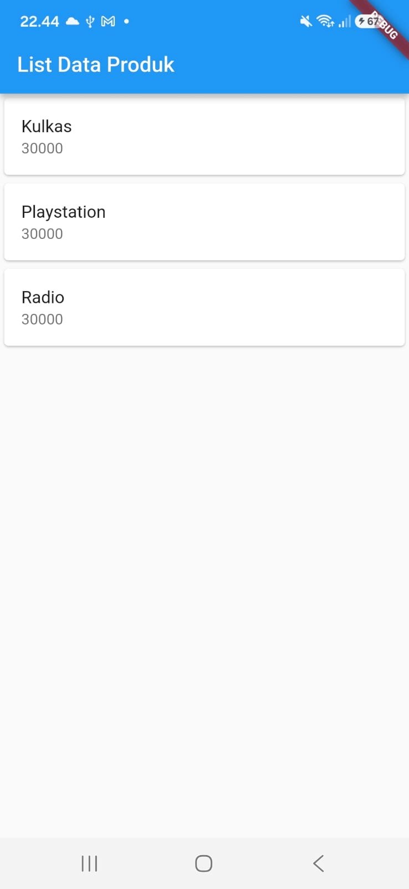

# Laporan Praktikum Pemrograman Mobile

**Nama**        : Wakhid Nugroho  
**NIM**         : H1D024003  
**Shift**       : Awal H / Akhir C  
**Praktikum**   : Pemrograman Mobile

---

## 📝 Tugas 1
**Tanggal**: Selasa, 27 Oktober 2026

**Kesimpulan Praktikum:**  
Pada praktikum Modul 2 ini, praktikan mempelajari dasar-dasar pengenalan dan perancangan antarmuka aplikasi menggunakan framework Flutter dan bahasa pemrograman Dart. Praktikan memahami perbedaan konsep antara `StatelessWidget` (widget statis) dan `StatefulWidget` (widget dinamis yang mengelola state), memisahkan struktur kode ke dalam beberapa berkas `.dart` secara modular, serta menyusun tata letak antarmuka menggunakan widget layout seperti `Column` (tampilan vertikal) dan `Row` (tampilan horizontal). Selain itu, praktikan berhasil mengimplementasikan form input interaktif menggunakan `TextField` dan `TextEditingController` untuk menangkap data produk dan mengirimkannya ke halaman detail via `Navigator` serta `MaterialPageRoute`, serta menyajikan sekumpulan data secara terstruktur dan efisien menggunakan widget `ListView`, `Card`, dan `ListTile`.
